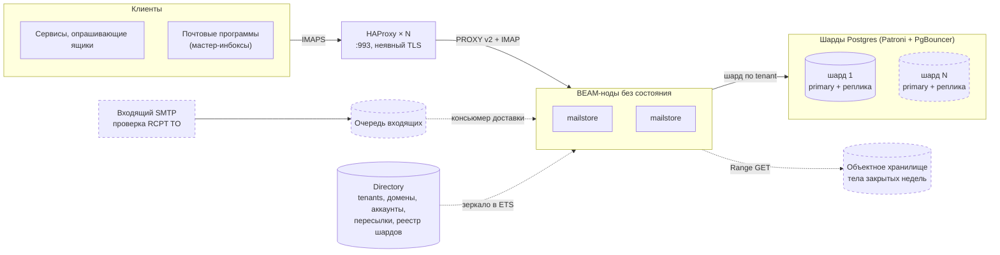
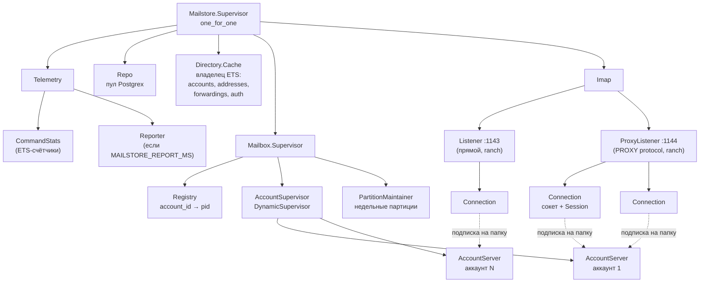
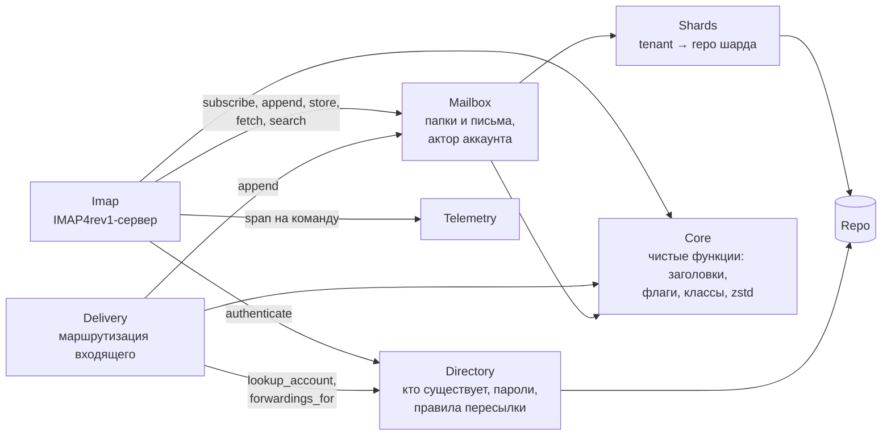
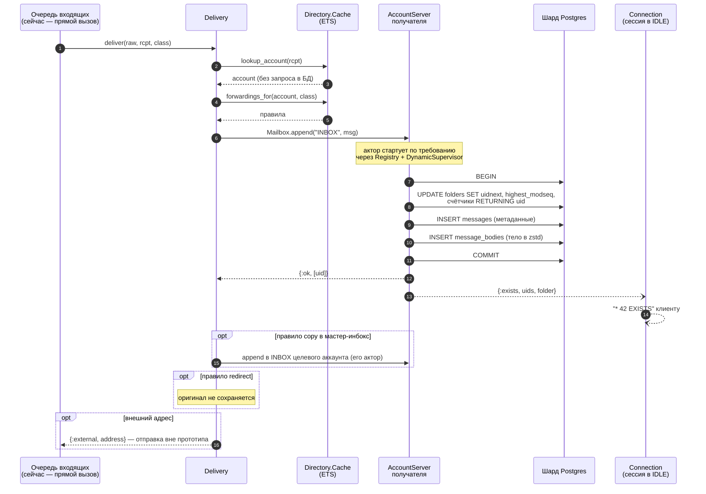
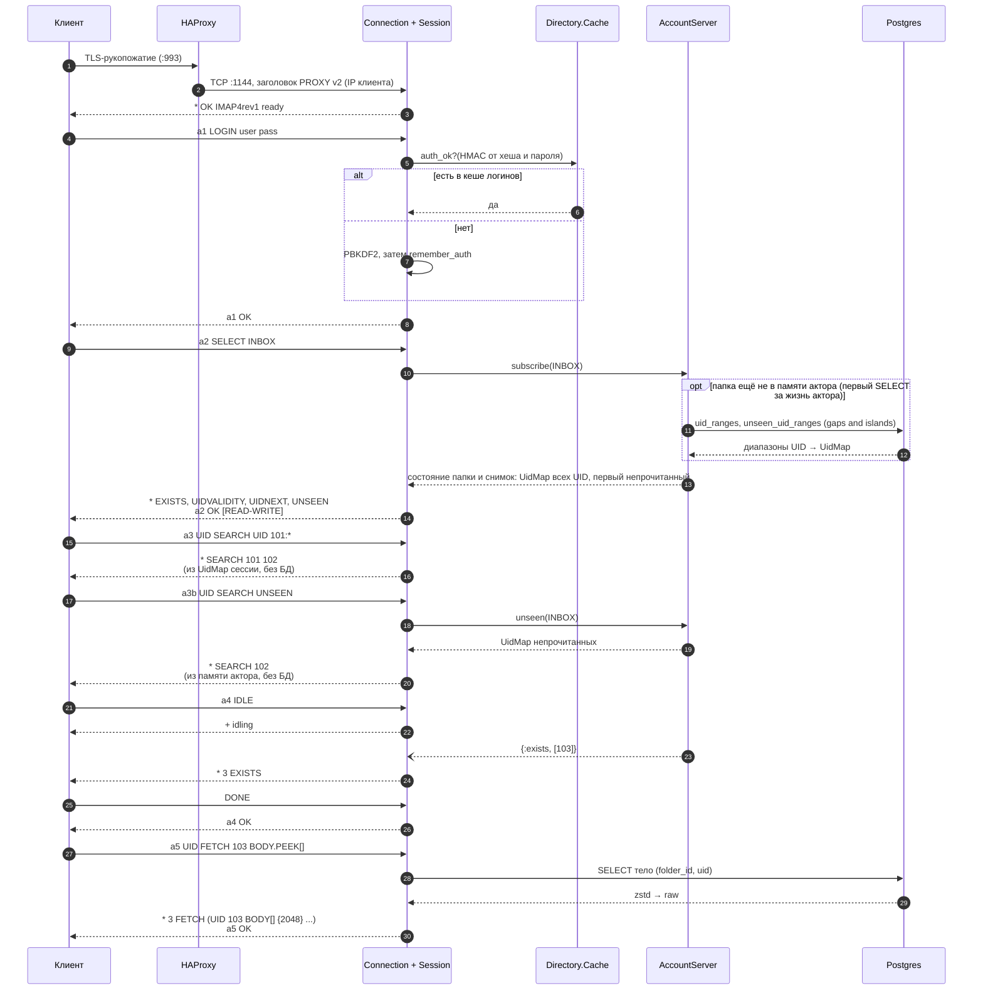
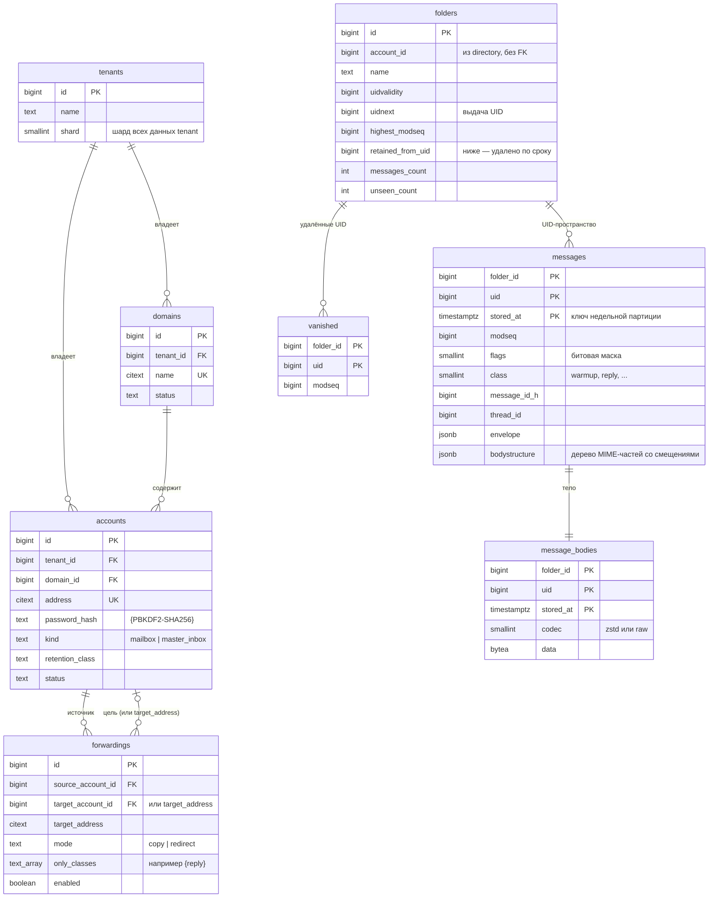
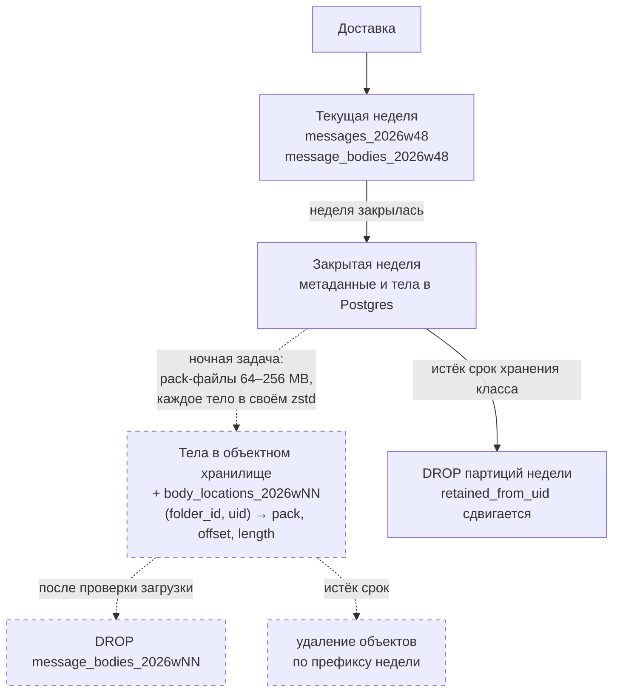

# Архитектура mailstore

Диаграммы в формате Mermaid, GitHub рисует их прямо в этом файле. Пунктиром обозначено то, чего в прототипе ещё нет (запланировано).

1. [Целевое развёртывание](#1-целевое-развёртывание)
2. [Дерево процессов BEAM-ноды](#2-дерево-процессов-beam-ноды)
3. [Контексты и зависимости](#3-контексты-и-зависимости)
4. [Доставка письма](#4-доставка-письма)
5. [IMAP-сессия](#5-imap-сессия)
6. [Схема данных](#6-схема-данных)
7. [Жизненный цикл письма в хранилище](#7-жизненный-цикл-письма-в-хранилище)

## 1. Целевое развёртывание

Вычисления и хранение разделены. BEAM-ноды не хранят состояния: любой ящик обслуживается на любой ноде, а ноды добавляются под нагрузку. Данные лежат в шардах Postgres, шард выбирается по tenant. TLS снимает HAProxy.

Масштабирование по ресурсу:

| Что кончилось | Что добавить |
|---|---|
| CPU на команды IMAP | BEAM-ноду (клиенты переподключаются и распределяются сами) |
| CPU на TLS | экземпляр HAProxy |
| Место или запись в БД | шард Postgres, перенос tenant без простоя |
| Место под старые тела | объём объектного хранилища |

## 2. Дерево процессов BEAM-ноды

На каждое активное соединение — процесс `Imap.Connection`, на каждый активный аккаунт — один актор `AccountServer`, сколько бы сессий его ни открыло. Актор живёт, пока есть подписчики, и ещё `account_idle_timeout` после них. Для открытых папок он держит в памяти все UID и непрочитанные (диапазонами, `Core.UidMap`) и обновляет их на каждой своей записи, поэтому SELECT и UNSEEN не ходят в базу.

`Imap.Session` — не процесс, а чистая машина состояний внутри `Connection`: на вход команда или уведомление актора, на выход байты ответа.

## 3. Контексты и зависимости

Контекст — один публичный модуль, внутренности лежат в одноимённой папке. Контексты обращаются друг к другу только через публичные модули и никогда не трогают чужие схемы.

## 4. Доставка письма

Письмо разбирается один раз (`Core.NewMessage`: заголовки, ENVELOPE и дерево MIME-частей со смещениями из `Core.Mime`), затем применяются правила пересылки: копия в мастер-инбокс (с фильтром по классу, чтобы warmup туда не попадал), redirect без сохранения оригинала или внешняя пересылка. UID выдаёт база атомарным `UPDATE ... RETURNING`, актор только упорядочивает записи и рассылает изменения сессиям.

## 5. IMAP-сессия

Типичный клиент: подключение через HAProxy, LOGIN, SELECT, затем IDLE или периодический опрос. Горячие команды отвечаются без БД: LOGIN из кеша логинов, STATUS, SELECT и `UID SEARCH UNSEEN` из памяти актора, `UID SEARCH UID n:*` из таблицы UID сессии.

Уведомления от актора (EXISTS, FLAGS, EXPUNGE) отправляются только там, где их разрешает протокол: сразу во время IDLE и в конце команды. Во время FETCH, STORE и SEARCH без UID EXPUNGE откладывается, чтобы у клиента не съехали номера.

## 6. Схема данных

Directory — одна глобальная база (в прототипе — та же, что и шард). Шард хранит почту своих tenants. Внешних ключей между ними нет: в целевой схеме это разные базы.

Индексы `messages`: `(folder_id, modseq)` для CONDSTORE, частичный `(folder_id, uid) WHERE NOT \Seen` для UNSEEN, `(tenant_id, message_id_h)` и `thread_id` для тредов.

## 7. Жизненный цикл письма в хранилище

`messages` и `message_bodies` разбиты на недельные партиции по `stored_at`. Закрытая неделя неизменяема (флаги меняются только в метаданных), поэтому её тела можно упаковать и унести в объектное хранилище, а удаление по сроку — это `DROP` партиции, а не `DELETE`.

Сроки хранения различаются по классам писем (например, warmup короче, ответы дольше): классы пишутся в отдельные партиции и удаляются целиком. Сейчас в прототипе один класс хранения.
