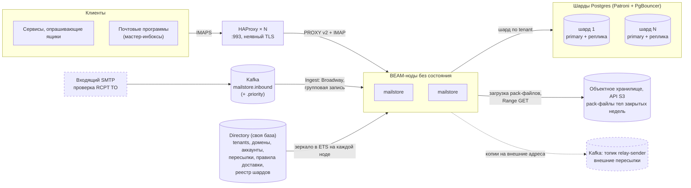
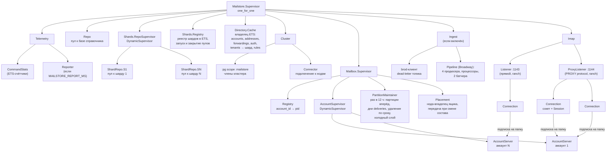
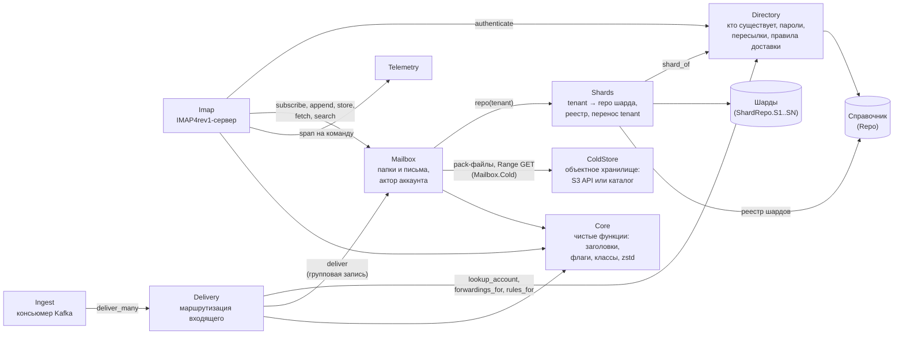
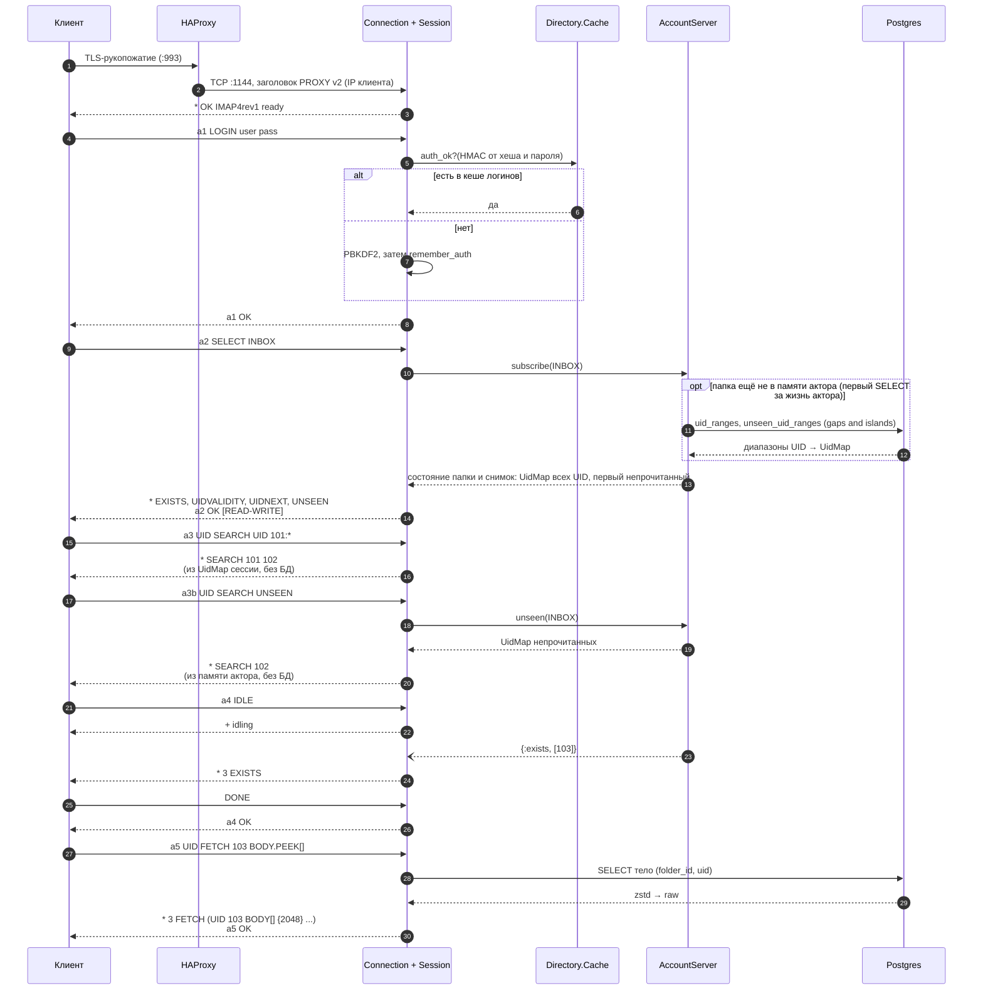
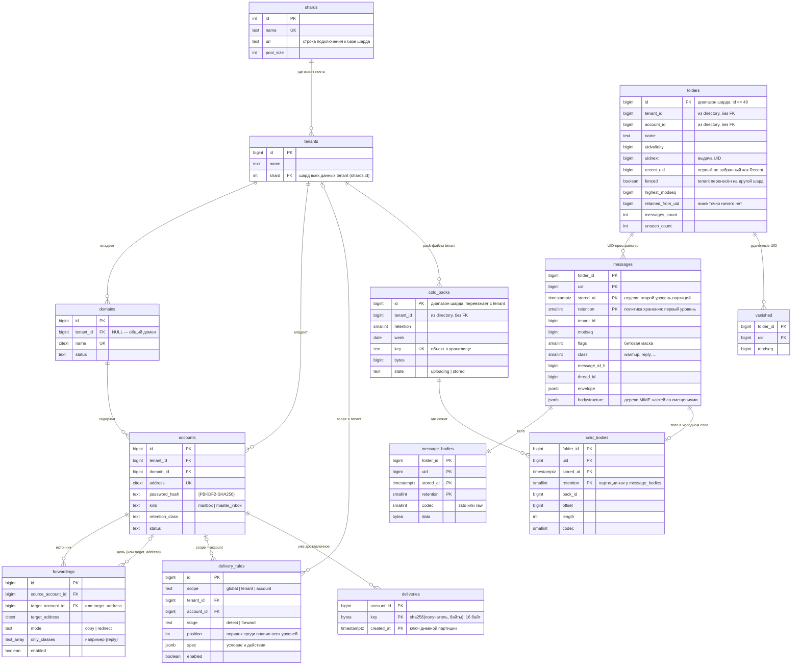
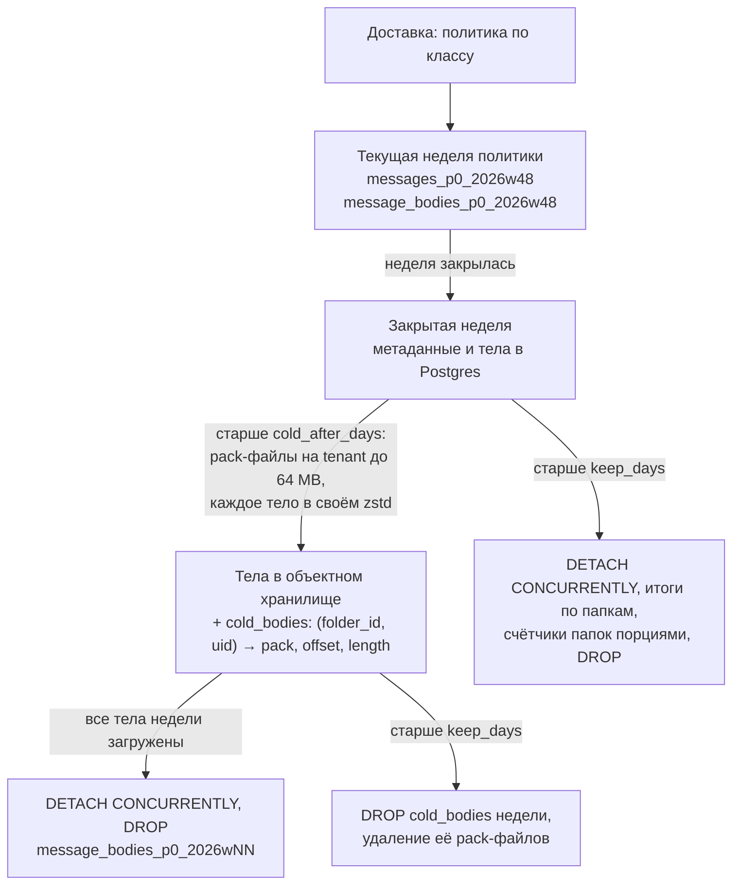
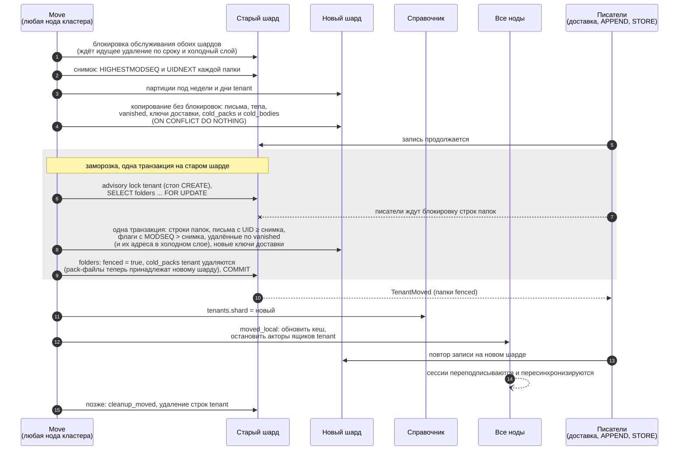

# Архитектура mailstore

Диаграммы в формате Mermaid, GitHub рисует их прямо в этом файле. Пунктиром обозначено то, чего в прототипе ещё нет (запланировано).

1. [Целевое развёртывание](#1-целевое-развёртывание)
2. [Дерево процессов BEAM-ноды](#2-дерево-процессов-beam-ноды)
3. [Контексты и зависимости](#3-контексты-и-зависимости)
4. [Доставка письма](#4-доставка-письма)
5. [IMAP-сессия](#5-imap-сессия)
6. [Схема данных](#6-схема-данных)
7. [Жизненный цикл письма в хранилище](#7-жизненный-цикл-письма-в-хранилище)
8. [Перенос tenant на другой шард](#8-перенос-tenant-на-другой-шард)

## 1. Целевое развёртывание

Вычисления и хранение разделены. BEAM-ноды не хранят состояния: любой ящик обслуживается на любой ноде, а ноды добавляются под нагрузку. Данные лежат в шардах Postgres, шард выбирается по tenant; тела старых недель уходят в объектное хранилище. TLS снимает HAProxy.

Масштабирование по ресурсу:

| Что кончилось | Что добавить |
|---|---|
| CPU на команды IMAP | BEAM-ноду (клиенты переподключаются и распределяются сами) |
| CPU на TLS | экземпляр HAProxy |
| Место или запись в БД | шард Postgres, перенос tenant без простоя |
| Место под старые тела | объём объектного хранилища (тела старше `cold_after_days` уходят туда) |

## 2. Дерево процессов BEAM-ноды

На каждое активное соединение — процесс `Imap.Connection`, на каждый активный аккаунт — один актор `AccountServer` во всём кластере, сколько бы сессий на скольких нодах его ни открыло. Актор работает на ноде-владельце (`Mailbox.Placement`: rendezvous-хеширование по `account_id` среди нод группы `:pg`), вызовы с других нод приходят через `:erpc`, а push-уведомления уходят сессиям на любой ноде. При смене состава кластера нода останавливает акторы ящиков, которые ей больше не принадлежат, и их сессии переподписываются у нового владельца. Актор живёт, пока есть подписчики, и ещё `account_idle_timeout` после них. Для открытых папок он держит в памяти все UID и непрочитанные (диапазонами, `Core.UidMap`) и обновляет их на каждой своей записи, поэтому SELECT и UNSEEN не ходят в базу.

`Imap.Session` — не процесс, а чистая машина состояний внутри `Connection`: на вход команда или уведомление актора, на выход байты ответа.

Пул к каждому шарду — отдельный модуль репозитория (`Mailstore.ShardRepo.S<id>`), его создаёт `Shards.Registry` при загрузке реестра из справочника. Реестр перечитывается раз в 30 секунд и по сигналу после `Shards.register`, поэтому шард добавляется без перезапуска нод. Пулы шардов, пропавших из реестра, закрываются.

## 3. Контексты и зависимости

Контекст — один публичный модуль, внутренности лежат в одноимённой папке. Контексты обращаются друг к другу только через публичные модули и никогда не трогают чужие схемы.

## 4. Доставка письма

Записи из Kafka разбирают процессоры Broadway, параллельно: JSON, заголовки, ENVELOPE и дерево MIME-частей (`Core.NewMessage`), правила доставки вместо sieve (`Core.Rules`: теги warmup, удаление, отказы, исключения из пересылки), сжатие тела. Затем применяются правила пересылки: копия в мастер-инбокс (с фильтром по классу, чтобы warmup туда не попадал), redirect без сохранения оригинала или внешняя пересылка. Пачка до 200 записей (или за 200 мс) пишется одной транзакцией на шард, мимо акторов. Повтор пачки безопасен: ключ доставки (хеш получателя и байтов письма) записывается в `deliveries` в той же транзакции, и уже доставленное не пишется второй раз. Офсеты коммитятся в Kafka раз в несколько секунд. После коммита запущенные акторы получателей узнают, что пришло, и рассылают EXISTS своим сессиям.

UID папки коммитятся по возрастанию: строка папки заблокирована от выдачи UID до коммита. Уведомления от разных писателей (групповая запись, собственные APPEND и COPY актора) могут прийти не по порядку. Поэтому актор помнит первый UID, о котором ещё не сообщал. Если новые UID начинаются выше него, промежуточные уже закоммичены и он дочитывает их из базы, а запоздавшее уведомление пропускает. Сессия видит каждый UID один раз и по возрастанию.

## 5. IMAP-сессия

Типичный клиент: подключение через HAProxy, LOGIN, SELECT, затем IDLE или периодический опрос. Горячие команды отвечаются без БД: LOGIN из кеша логинов, STATUS, SELECT и `UID SEARCH UNSEEN` из памяти актора, `UID SEARCH UID n:*` из таблицы UID сессии.

Уведомления от актора (EXISTS, FLAGS, EXPUNGE) отправляются только там, где их разрешает протокол: сразу во время IDLE и в конце команды. Во время FETCH, STORE и SEARCH без UID EXPUNGE откладывается, чтобы у клиента не съехали номера.

## 6. Схема данных

Справочник (directory) — одна глобальная база со своей схемой (`priv/repo/migrations`): tenants, домены (в том числе общие, без владельца), ящики, пересылки, правила доставки, реестр шардов. Каждый шард — отдельная база со схемой шарда (`priv/shard/migrations`), в ней почта своих tenants и адреса их тел в холодном слое (`cold_packs`, `cold_bodies`). Внешних ключей и общих транзакций между ними нет. В разработке это базы одного сервера Postgres (`mailstore_dev`, `mailstore_dev_shard1`, ...). На диаграмме ниже обе схемы вместе, связи между ними логические.

Каждый шард выдаёт id папок из своего диапазона (`shard_id << 40`), поэтому папки переносятся между шардами с теми же id, UID, UIDVALIDITY и MODSEQ.

Индексы `messages`: `(folder_id, modseq)` для CONDSTORE, частичный `(folder_id, uid) WHERE NOT \Seen` для UNSEEN, `(tenant_id, message_id_h)` и `thread_id` для тредов.

`deliveries` помнит доставленное на срок, дольше которого ничего нельзя переиграть: хранение исходных топиков и dead-letter топика (по умолчанию 8 дней). Партиции дневные, старые удаляются `DROP`. Время вставки недетерминировано, поэтому повтор, попавший на другой день, ловит не первичный ключ, а проверка `NOT EXISTS` по всем партициям перед вставкой. Ключ закрывает только гонку двух транзакций в один день.

## 7. Жизненный цикл письма в хранилище

**Политики хранения** (`Mailbox.Retention`) задаются в конфиге, а не в коде. У политики есть срок хранения и, по желанию, срок, после которого тела уходят в холодный слой. Классы писем сопоставляются политикам. Настройки по умолчанию:

| Политика | Классы | Хранится | Холодный слой |
|---|---|---|---|
| `standard` (id 0) | все, кроме warmup | 365 дней | тела старше 30 дней |
| `short` (id 1) | warmup | 30 дней | нет |

Письмо получает политику своего класса при записи и сохраняет её при копировании и переносе. Изменение сопоставления касается только новых писем. `messages` и `message_bodies` разбиты на партиции в два уровня: по политике, внутри неё по неделе `stored_at` (`messages_p1_2026w48`). Неделю одной политики можно удалить целиком, а письма других политик той же недели останутся. Неделя удаляется, когда со дня её окончания прошло больше срока хранения. Поэтому письмо живёт не меньше срока и не больше чем на неделю дольше.

**Удаление по сроку** (`Mailbox.apply_retention/1`) запускает `PartitionMaintainer` раз в 12 часов на каждой ноде. Для каждого шарда и каждой политики одновременно работает только один запуск: его держит advisory lock. Трафик удаление не блокирует, а упавший посреди дороги запуск продолжает следующий:

1. Неделя отцепляется через `DETACH PARTITION … CONCURRENTLY`. С этого момента её не видит ни один запрос, и изменить её уже нельзя.
2. Одна транзакция заменяет отцепленную таблицу итогами по папкам: сколько писем и сколько непрочитанных.
3. Счётчики папок уменьшаются порциями по 1 000 папок, каждая порция — короткая транзакция в порядке id, как у всех, кто пишет в `folders`. HIGHESTMODSEQ растёт. Сразу после порции акторы её ящиков на любых нодах перечитывают папки, и открытые сессии получают `EXPUNGE`. Старую картину клиент видит только между отцеплением недели и порцией своей папки.
4. Тела недели отцепляются и удаляются так же.

Удаление по сроку и перенос tenant на одном шарде не идут одновременно. Перенос держит блокировку обслуживания обоих шардов и ждёт, пока закончится уже идущее удаление, а удаление, начатое во время переноса, этот шард пропускает до следующего запуска. Иначе неделя, удалённая между копированием писем и копированием строк папок, дала бы на новом шарде заниженные счётчики.

Удалённые так UID не пишутся в `vanished`. Сессия узнаёт их при пересинхронизации, а для QRESYNC VANISHED можно вычислить по оставшимся UID: RFC 7162 разрешает включать в ответ UID, которых не было. `retained_from_uid` значит «ниже этого UID писем точно нет». Удаление по политикам выбивает UID вперемешку, поэтому эту отметку оно не двигает.

**Холодный слой** (`Mailbox.Cold`, `ColdStore`). Тела закрытых недель политик с `cold_after_days` уходят в объектное хранилище. Метаданные и флаги остаются в Postgres, поэтому STORE, SEARCH по флагам и STATUS работают как раньше.

- **Pack-файл** — один объект на tenant, политику и неделю; если тел больше 64 MB, их несколько. Внутри тела в том виде, как лежали в Postgres (каждое сжато отдельно), затем индекс `{folder_id, uid, offset, length, codec}` и метка. Pack-файл читается и без базы. В нём только письма одного tenant, поэтому при переносе tenant на другой шард его pack-файлы переезжают вместе со строками `cold_packs` и `cold_bodies`.
- **Перенос недели** запускается раз в 12 часов, на каждом шарде для каждой политики одновременно только один запуск, и не во время переноса tenant:
  1. Удаляются pack-файлы, оставшиеся в состоянии `uploading` после упавшего запуска.
  2. По каждому tenant: строка `cold_packs` в состоянии `uploading`, затем загрузка с Content-MD5 (хранилище само отвергает повреждённые данные) и проверка размера. Затем одна транзакция пишет адреса тел в `cold_bodies` и переводит pack-файл в `stored`.
  3. Когда у всех тел недели есть адрес, горячая партиция тел отцепляется и удаляется.
- **Чтение**: сначала Postgres, недостающие тела берутся из `cold_bodies` через Range GET. Близкие куски одного pack-файла забираются одним запросом, разные pack-файлы — параллельно. На стенде с SeaweedFS FETCH одного старого письма занимает p50 1,3 мс (из Postgres — 0,22 мс), 100 подряд идущих — 6 мс. У AWS S3 первый байт приходит через десятки миллисекунд.
- **EXPUNGE** удаляет адрес тела, а байты остаются в pack-файле до удаления недели по сроку. **COPY** старого письма возвращает его тело в Postgres, в текущую неделю: у копии своя неделя, а pack-файлы исходной недели удалятся раньше. **Удаление по сроку** снимает партицию `cold_bodies` недели и удаляет её pack-файлы.

Исходим из того, что старые письма практически не читают: порядка одного на миллион. Это допущение, не замер, логов чтения нет. Поэтому задержка Range GET приемлема, а цена чтения не важна.

Хранилище — любое с API S3 (`ColdStore.S3`) или локальный каталог (`ColdStore.Local`, для разработки и тестов). Проверено на SeaweedFS. В коде AWS S3 и MinIO не различаются, меняется только адрес. Различия эксплуатационные:
- у S3 запросы платные, но pack-файлов мало, а чтений почти нет;
- классы с отложенным доступом (Glacier) не подходят: там нет быстрого Range GET;
- у S3 Standard-IA минимальный срок хранения 30 дней, нам это не мешает;
- MinIO означает своё железо и его обслуживание. Его образы больше не публикуются ни на Docker Hub, ни на quay.io, поэтому для разработки в `docker-compose.yml` стоит SeaweedFS.

## 8. Перенос tenant на другой шард

`Shards.move_tenant/2` переносит tenant, пока его ящики получают почту и обслуживают IMAP. Запись к tenant останавливается только на время заморозки: доливается дельта, накопленная за время копирования, а не весь объём. На стенде с непрерывной записью: 140 писем в дельте, заморозка 35 мс, весь перенос 245 мс.

Pack-файлы tenant содержат только его письма, поэтому сами объекты не копируются: переезжают строки, которые на них указывают. Удаление по сроку на старом шарде их больше не видит и не трогает.

Если перенос упал до коммита на старом шарде, tenant остаётся на месте, а частичные данные на новом шарде перезапишет следующая попытка. Если упал после коммита, но до переключения, tenant закрыт на старом шарде и ещё не виден на новом: писатели повторяют попытки, а `Move.finish/2` доводит переключение. Сам он пока не продолжает прерванный перенос: `finish` запускают вручную.
