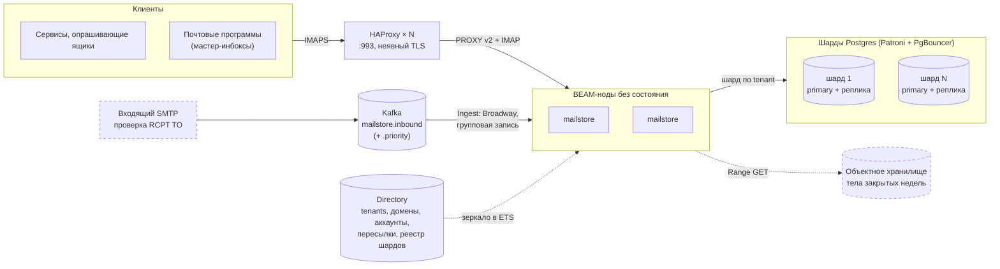
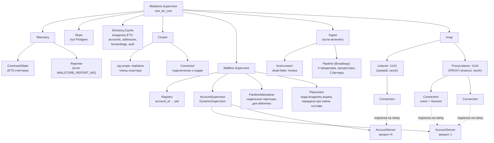
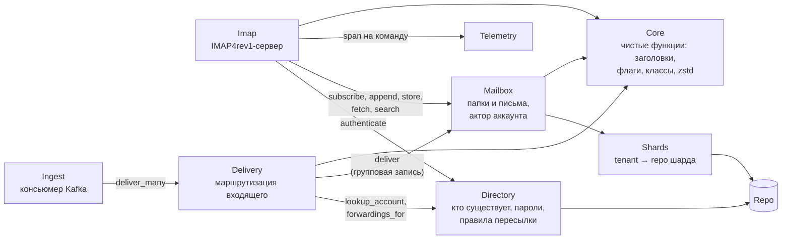
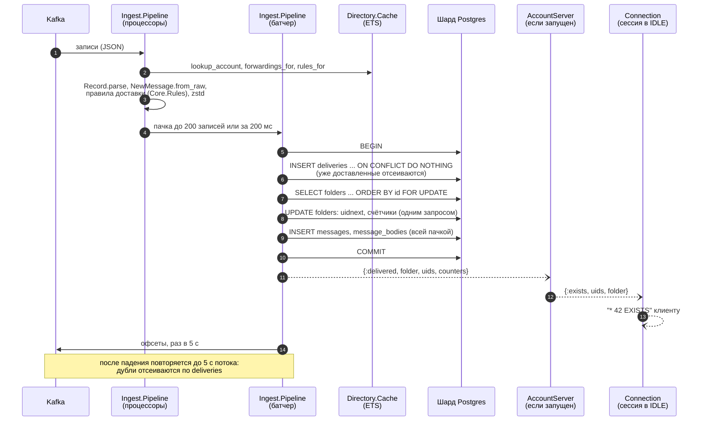
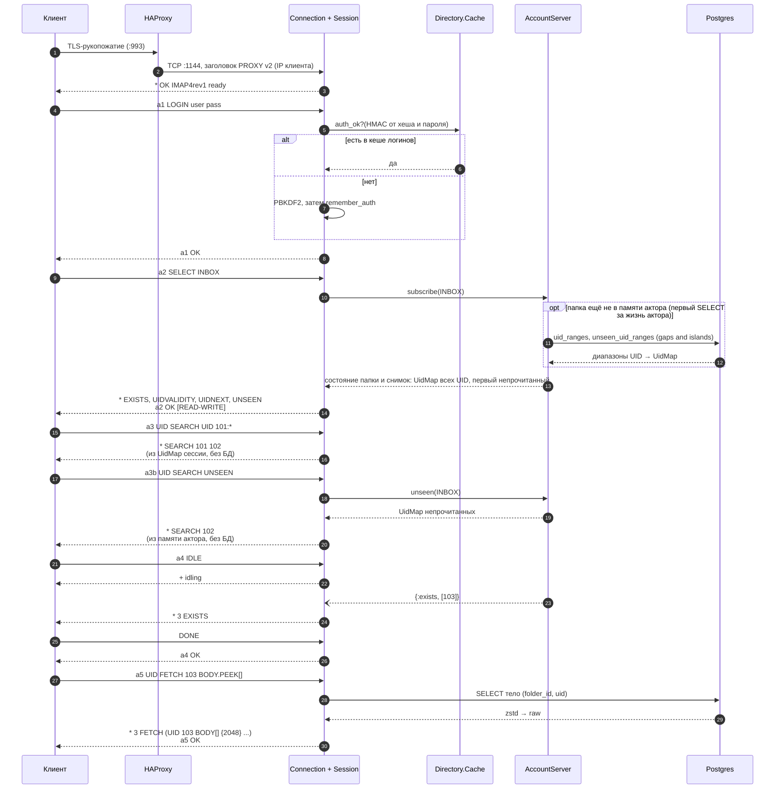
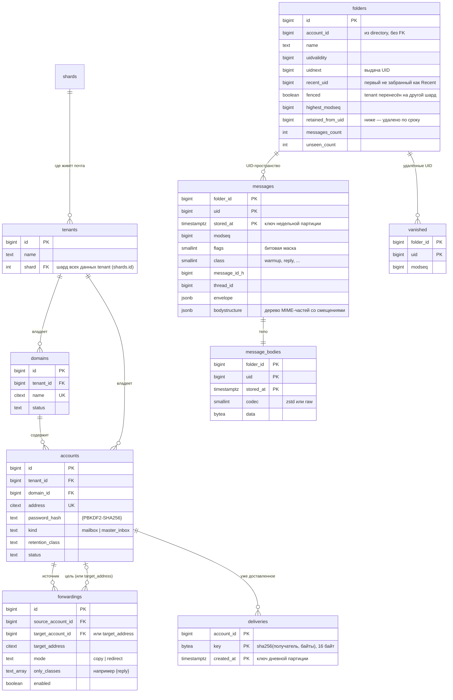
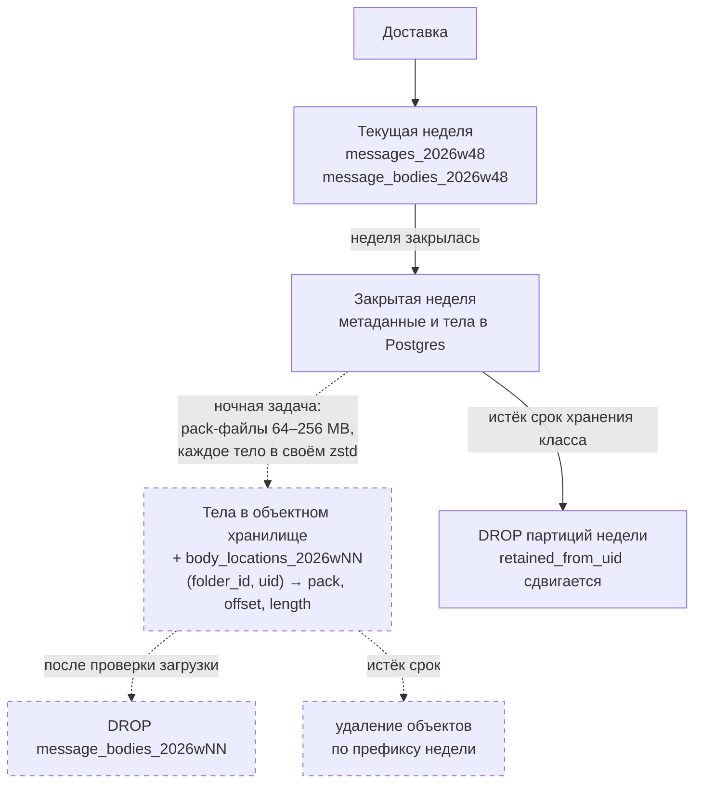

# Архитектура mailstore

Диаграммы в формате Mermaid, GitHub рисует их прямо в этом файле. Пунктиром обозначено то, чего в прототипе ещё нет (запланировано).

1. [Целевое развёртывание](#1-целевое-развёртывание)
2. [Дерево процессов BEAM-ноды](#2-дерево-процессов-beam-ноды)
3. [Контексты и зависимости](#3-контексты-и-зависимости)
4. [Доставка письма](#4-доставка-письма)
5. [IMAP-сессия](#5-imap-сессия)
6. [Схема данных](#6-схема-данных)
7. [Жизненный цикл письма в хранилище](#7-жизненный-цикл-письма-в-хранилище)

## 1. Целевое развёртывание

Вычисления и хранение разделены. BEAM-ноды не хранят состояния: любой ящик обслуживается на любой ноде, а ноды добавляются под нагрузку. Данные лежат в шардах Postgres, шард выбирается по tenant. TLS снимает HAProxy.

Масштабирование по ресурсу:

| Что кончилось | Что добавить |
|---|---|
| CPU на команды IMAP | BEAM-ноду (клиенты переподключаются и распределяются сами) |
| CPU на TLS | экземпляр HAProxy |
| Место или запись в БД | шард Postgres, перенос tenant без простоя |
| Место под старые тела | объём объектного хранилища |

## 2. Дерево процессов BEAM-ноды

На каждое активное соединение — процесс `Imap.Connection`, на каждый активный аккаунт — один актор `AccountServer` во всём кластере, сколько бы сессий на скольких нодах его ни открыло. Актор работает на ноде-владельце (`Mailbox.Placement`: rendezvous-хеширование по `account_id` среди нод группы `:pg`), вызовы с других нод приходят через `:erpc`, а push-уведомления уходят сессиям на любой ноде. При смене состава кластера нода останавливает акторы ящиков, которые ей больше не принадлежат, и их сессии переподписываются у нового владельца. Актор живёт, пока есть подписчики, и ещё `account_idle_timeout` после них. Для открытых папок он держит в памяти все UID и непрочитанные (диапазонами, `Core.UidMap`) и обновляет их на каждой своей записи, поэтому SELECT и UNSEEN не ходят в базу.

`Imap.Session` — не процесс, а чистая машина состояний внутри `Connection`: на вход команда или уведомление актора, на выход байты ответа.

## 3. Контексты и зависимости

Контекст — один публичный модуль, внутренности лежат в одноимённой папке. Контексты обращаются друг к другу только через публичные модули и никогда не трогают чужие схемы.

## 4. Доставка письма

Записи из Kafka разбирают процессоры Broadway, параллельно: JSON, заголовки, ENVELOPE и дерево MIME-частей (`Core.NewMessage`), правила доставки вместо sieve (`Core.Rules`: теги warmup, удаление, отказы, исключения из пересылки), сжатие тела. Затем применяются правила пересылки: копия в мастер-инбокс (с фильтром по классу, чтобы warmup туда не попадал), redirect без сохранения оригинала или внешняя пересылка. Пачка до 200 записей (или за 200 мс) пишется одной транзакцией на шард, мимо акторов. Повтор пачки безопасен: ключ доставки (хеш получателя и байтов письма) записывается в `deliveries` в той же транзакции, и уже доставленное не пишется второй раз. Офсеты коммитятся в Kafka раз в несколько секунд. После коммита запущенные акторы получателей узнают, что пришло, и рассылают EXISTS своим сессиям.

UID папки коммитятся по возрастанию: строка папки заблокирована от выдачи UID до коммита. Уведомления от разных писателей (групповая запись, собственные APPEND и COPY актора) могут прийти не по порядку. Поэтому актор помнит первый UID, о котором ещё не сообщал. Если новые UID начинаются выше него, промежуточные уже закоммичены и он дочитывает их из базы, а запоздавшее уведомление пропускает. Сессия видит каждый UID один раз и по возрастанию.

## 5. IMAP-сессия

Типичный клиент: подключение через HAProxy, LOGIN, SELECT, затем IDLE или периодический опрос. Горячие команды отвечаются без БД: LOGIN из кеша логинов, STATUS, SELECT и `UID SEARCH UNSEEN` из памяти актора, `UID SEARCH UID n:*` из таблицы UID сессии.

Уведомления от актора (EXISTS, FLAGS, EXPUNGE) отправляются только там, где их разрешает протокол: сразу во время IDLE и в конце команды. Во время FETCH, STORE и SEARCH без UID EXPUNGE откладывается, чтобы у клиента не съехали номера.

## 6. Схема данных

Справочник (directory) — одна глобальная база со своей схемой (`priv/repo/migrations`): tenants, домены, ящики, правила, реестр шардов. Каждый шард — отдельная база со схемой шарда (`priv/shard/migrations`), в ней почта своих tenants. Внешних ключей и общих транзакций между ними нет. В разработке это базы одного сервера Postgres (`mailstore_dev`, `mailstore_dev_shard1`, ...). На диаграмме ниже обе схемы вместе, связи между ними логические.

Индексы `messages`: `(folder_id, modseq)` для CONDSTORE, частичный `(folder_id, uid) WHERE NOT \Seen` для UNSEEN, `(tenant_id, message_id_h)` и `thread_id` для тредов.

`deliveries` помнит доставленное на срок, дольше которого ничего нельзя переиграть: хранение исходных топиков и dead-letter топика (по умолчанию 8 дней). Партиции дневные, старые удаляются `DROP`. Время вставки недетерминировано, поэтому повтор, попавший на другой день, ловит не первичный ключ, а проверка `NOT EXISTS` по всем партициям перед вставкой. Ключ закрывает только гонку двух транзакций в один день.

## 7. Жизненный цикл письма в хранилище

`messages` и `message_bodies` разбиты на недельные партиции по `stored_at`. Закрытая неделя неизменяема (флаги меняются только в метаданных), поэтому её тела можно упаковать и унести в объектное хранилище, а удаление по сроку — это `DROP` партиции, а не `DELETE`.

Сроки хранения различаются по классам писем (например, warmup короче, ответы дольше): классы пишутся в отдельные партиции и удаляются целиком. Сейчас в прототипе один класс хранения.
